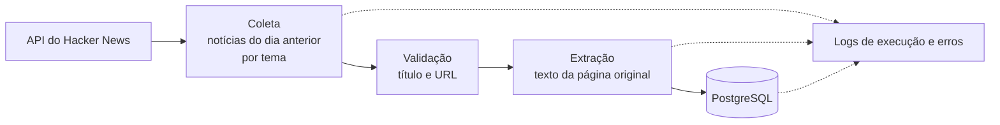

# TechNews

Pipeline de dados em Python que coleta, valida e organiza notícias de tecnologia em um banco PostgreSQL.

Projeto de estudo de **backend e engenharia de dados**, escrito à mão para praticar consumo de APIs, tratamento e validação de dados, extração de conteúdo web, persistência relacional e organização de um pipeline em módulos.

## Como funciona

1. **Coleta.** Consulta a API do Hacker News em busca das notícias do dia anterior sobre temas como linguagens de programação, inteligência artificial, engenharia de dados e DevOps.
2. **Validação e extração.** Para cada resultado, verifica se há título e URL válidos e tenta extrair o conteúdo textual da página original.
3. **Armazenamento.** Grava as notícias no PostgreSQL.

Um script coordena as três etapas, que ficam em módulos separados.

## Modelo de dados

Cada notícia guarda:

| Campo | Descrição |
|---|---|
| Identificador externo | ID da notícia na fonte |
| Título | Título da notícia |
| URL | Link da página original |
| Fonte | De onde a notícia veio (hoje, Hacker News) |
| Conteúdo | Texto extraído da página original |
| Data de publicação | Quando a notícia foi publicada |

**Duplicatas:** a combinação de fonte + identificador externo é única, então rodar o pipeline de novo não duplica notícias.

**Logs:** o sistema registra a execução e os erros de coleta, extração e gravação.

## Stack

`Python` · `PostgreSQL` · API do Hacker News · extração de conteúdo web

## Status

**Em desenvolvimento.** O fluxo integrado já coleta do Hacker News e grava no PostgreSQL.

Ainda não estão no fluxo principal: interface web, resumo gerado por IA e execução agendada. Esses recursos, junto com novas fontes, podem fazer parte das próximas etapas.

## Autor

Vitor Brosque · [LinkedIn](https://www.linkedin.com/in/vitorbrosque) · [GitHub](https://github.com/Vitor-Brosque)
